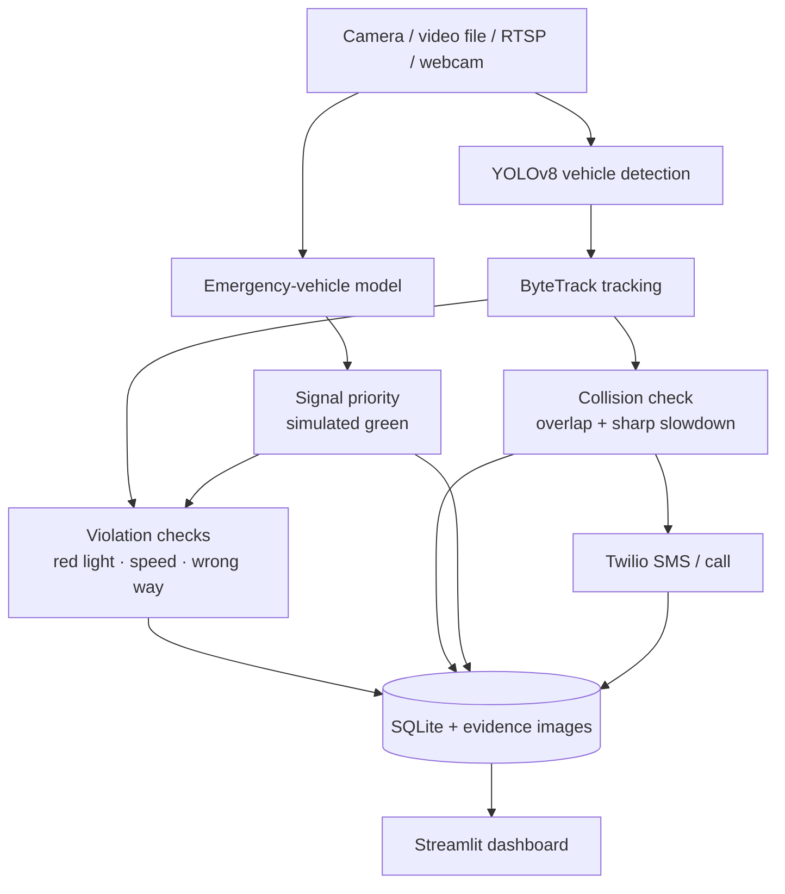

# 🚦 AI-Based Smart Traffic Monitoring and Automated Traffic Violation Enforcement System

An AI-powered traffic agent that watches camera footage, tracks vehicles,
detects traffic violations and possible collisions, gives priority to emergency
vehicles, and sends alerts. Built with **YOLOv8, ByteTrack, OpenCV, Streamlit,
SQLite and Twilio**.

[](https://github.com/aditya182005/Real_Time_AI_Traffic_Monitoring_Violation_Enforcement/actions/workflows/ci.yml)


> **Status:** an academic final-year project. All planned modules are
> implemented and unit-tested. Accuracy on real traffic footage has **not**
> been measured yet (see [Evaluation](#-evaluation-metrics)). The traffic
> signal is simulated; no real signal hardware is controlled.

## Contents

[Overview](#-project-overview) ·
[Features](#-what-you-can-do-with-it) ·
[Goals](#-project-goals) ·
[Architecture](#-system-architecture) ·
[Tech stack](#-technology-stack) ·
[Project structure](#-project-structure) ·
[How to run](#-how-to-run) ·
[Evaluation](#-evaluation-metrics) ·
[Limitations](#-limitations) ·
[Future scope](#-future-scope) ·
[Documentation](#-documentation) ·
[Contributing](#-contributing)

---

## 📌 Project Overview

Traffic authorities have to watch many cameras, spot violations, and react
quickly to accidents and emergency vehicles. This project combines those
tasks in one pipeline. It reads traffic-camera video (a file, an RTSP stream
or a webcam), detects and tracks every vehicle, runs rule checks on the
tracks, stores each event with photographic evidence, and shows everything on
a web dashboard.

| Capability | How it works |
|---|---|
| 🚗 Vehicle detection and tracking | YOLOv8 finds cars, motorcycles, buses and trucks; ByteTrack keeps one ID per vehicle across frames |
| 🚦 Violation detection | Red-light, speeding and wrong-way checks, with a fine record for each |
| 💥 Collision detection | Two tracked vehicles overlap for several frames **and** one slows sharply |
| 🚑 Emergency priority | A custom model spots ambulances, fire trucks and police cars; the simulated signal turns green |
| 📲 Alerts | Twilio SMS (and optional voice call) for possible collisions |
| 📊 Dashboard | Streamlit pages for analysis, statistics, evidence and alerts |

---

## ✨ What You Can Do With It

* **Upload footage.** On **Analyze footage**, drop in traffic photos
  (JPG, PNG, BMP, WebP) or a video (MP4, AVI, MOV, MKV). Photos get vehicle
  counts and annotated downloads. Videos get the full pipeline, a live
  annotated preview and an annotated video to play or download.
* **Fit the checks to your camera.** The stop line, speed lines and wrong-way
  lane are sliders in percent of the frame, drawn on the first frame, so they
  work at any resolution.
* **Switch on the checks you need:** red light (against a simulated signal
  that is always red, always green or cycles, or one read from the traffic
  lamp in the video), speeding (two lines a known
  distance apart), wrong way, possible collisions, and emergency-vehicle
  priority.
* **Keep a record.** Every event is saved to SQLite with an annotated evidence
  frame and a cropped photo of the vehicle. The **Dashboard**, **Evidence** and
  **Alerts** pages show violations per hour, traffic density, violation types,
  filterable records, CSV export and Twilio alert status.
* **Watch a live camera.** **Live camera** analyzes an RTSP/HTTP stream or a
  webcam in the background, reconnects automatically, and skips frames when it
  falls behind.
* **Review before anything is final.** Each violation starts *pending*; an
  operator approves or rejects it on the Evidence page. Records carry evidence
  hashes and a hash chain, so `python -m app.integrity verify` shows whether
  anything was altered. Retention and plate erasure are in `python -m app.privacy`.
  See [docs/PRODUCTION.md](docs/PRODUCTION.md).
* **Read license plates (optional).** With EasyOCR installed, the plate of each
  violating vehicle is read, cleaned up and voted on across frames. Treat the
  result as a suggestion to verify.
* **Control who can do what.** Viewers watch, operators analyze and start
  cameras, admins also see the audit log and system status. Sign-in attempts
  are rate limited.
* **Alerts are opt-in.** SMS or voice alerts go out only when Twilio is
  configured **and** you turn alerts on for that run.
* **Issue an e-challan (PDF).** For an *approved* violation the Evidence page
  offers a one-page PDF with the facts, the fine, the evidence pictures and the
  record seal (`python -m app.challan --all-approved` for a batch). It is a demo
  document, not a legal notice.
* **Alert on Telegram too.** Set `TELEGRAM_BOT_TOKEN` and `TELEGRAM_CHAT_ID`
  and collision alerts also go to a chat, with the evidence picture.
* **Spot riders without a helmet (needs your own model).** `--helmet` with a
  trained `models/helmet.pt`; no helmet model ships with the project.
* **Try adaptive signal timing.** `python -m app.signals.adaptive` compares fixed
  and traffic-aware green times on a simulated four-way junction.
* **Show the signal on LEDs.** `--arduino-port COM3` mirrors the signal state to
  an Arduino with three LEDs (`hardware/arduino_signal/`).
* **Try it without your own footage.** `data/samples` has pictures of
  ambulances, fire trucks, police cars and ordinary vehicles, and
  `data/videos/demo_all_checks.mp4` triggers every check once.

---

## 🎯 Project Goals

1. Detect vehicles from traffic-camera video in real time.
2. Track vehicles across frames with persistent IDs.
3. Detect emergency vehicles (ambulances, fire trucks, police cars).
4. Give emergency vehicles a green signal (simulated).
5. Detect red-light, speeding and wrong-way violations and create digital
   fine records.
6. Detect possible collisions and notify a control room through Twilio.
7. Give traffic authorities a monitoring dashboard.
8. Store violation and event data in SQLite with evidence.

---

## 🏗️ System Architecture



Per frame, the pipeline detects, tracks, checks, and records. The decision
modules (`app/violation`) are pure Python, so they are tested without models.
Details, data model and design decisions are in
[docs/ARCHITECTURE.md](docs/ARCHITECTURE.md).

---

## 🛠️ Technology Stack

| Technology | Purpose |
|---|---|
| Python 3.11+ | Core implementation |
| YOLOv8 (Ultralytics) | Vehicle detection; custom emergency-vehicle model |
| ByteTrack (`supervision` < 0.31) | Multi-object tracking |
| OpenCV | Video reading, drawing, writing |
| Streamlit | Dashboard and upload interface |
| SQLite | Violation, collision, priority, density and audit storage |
| Twilio | SMS and voice alerts |
| EasyOCR (optional) | License-plate reading |
| imageio-ffmpeg | Re-encode results to H.264 for browser playback |
| pytest, GitHub Actions | Tests, CI, Docker build, real-model smoke test |
| Docker, nginx / Caddy, oauth2-proxy | Deployment |
| Google Colab / GitHub Actions | Training the emergency model without a local GPU |

Exact versions are in [`requirements.txt`](requirements.txt).

---

## 📂 Project Structure

```text
.
├── app/                        # The application (importable package)
│   ├── main.py                 #   Streamlit entry point and sidebar pages
│   ├── video_processor.py      #   The per-frame pipeline for one video
│   ├── analysis.py, media.py   #   Image analysis, settings, upload validation
│   ├── annotate.py             #   Drawing boxes, banners, calibration lines
│   ├── live.py                 #   RTSP / webcam capture and monitors
│   ├── plates.py               #   License-plate reading (optional)
│   ├── review.py, integrity.py #   Approve/reject; tamper-evident records
│   ├── fines.py, cameras.py    #   Fine table and per-camera profiles (JSON)
│   ├── privacy.py              #   Retention, export and erasure
│   ├── users.py, ratelimit.py  #   Accounts, password hashing, lockouts
│   ├── audit.py, health.py     #   Audit trail, logging, health checks
│   ├── paths.py, env.py        #   Where files live; .env loading
│   ├── detection/              #   YOLOv8 vehicle + emergency detectors
│   ├── tracking/               #   ByteTrack wrapper
│   ├── violation/              #   Red light, signal, speed, wrong way, collision, DB logger
│   ├── emergency/              #   Standalone signal-priority script
│   ├── alerts/                 #   Twilio SMS / voice alerts
│   ├── database/               #   Legacy tables
│   └── ui/                     #   Dashboard pages (upload, dashboard, evidence, ...)
│
├── scripts/                    # Command-line tools
│   ├── run_video.py            #   Run the whole pipeline on a video or stream
│   ├── evaluate.py             #   Precision / recall against labelled events
│   ├── check_setup.py          #   Is this computer ready?
│   ├── footage_report.py       #   Batch-run real clips and report false alarms / hits
│   ├── train_emergency.py      #   Train and install the emergency model
│   ├── build_emergency_dataset.py  # Merge downloaded datasets into one
│   ├── check_emergency_model.py    # False-alarm check on real held-out pictures
│   ├── fetch_coco_negatives.py #   Real pictures of ordinary cars/trucks/buses
│   ├── extract_frames.py       #   Pictures from your own videos
│   ├── make_demo_video.py      #   Rebuild the demo video and its truth file
│   ├── init_database.py        #   Create the database tables
│   └── manual_checks/          #   Hand-run demos (need models and video)
│
├── tests/                      # Automated tests (pytest; no model weights needed)
├── notebooks/                  # Google Colab notebooks for training
├── data/
│   ├── my_media/               #   Your own photos and videos (they appear in the app)
│   ├── samples/                #   Pictures for a quick check (+ README, credits)
│   ├── videos/                 #   traffic.mp4 and the all-checks demo video
│   ├── images/                 #   test image used by scripts/check_setup.py
├── models/                     # Put emergency_vehicle.pt here (not in git)
├── deploy/                     # nginx, Caddy, fail2ban, oauth2-proxy examples
├── docs/                       # Documentation (see below)
├── .github/workflows/          # CI and the emergency-model training workflow
├── .streamlit/config.toml      # Theme and the 200 MB upload limit
│
├── setup.bat / setup.sh        # First-time setup
├── start.bat / start.sh        # Start the dashboard
├── Dockerfile, docker-compose.yml
├── requirements.txt              # Core packages; extras are in requirements/
├── .env.example                # Copy to .env
├── CONTRIBUTING.md, CHANGELOG.md
└── README.md
```

Generated at run time and git-ignored: `outputs/` (evidence, videos, uploads),
`logs/`, `traffic_agent.db`, `runs/` (training), `models/*.pt`.

---

## ▶️ How to Run

### Quick start

1. **Get the code**
   ```bash
   git clone https://github.com/aditya182005/Real_Time_AI_Traffic_Monitoring_Violation_Enforcement.git
   cd Real_Time_AI_Traffic_Monitoring_Violation_Enforcement
   ```
2. **First-time setup**: `setup.bat` (Windows) or `./setup.sh` (macOS/Linux).
   It creates the virtual environment, installs the requirements and creates
   your `.env`. Manual route:
   ```bash
   python -m venv venv
   venv\Scripts\activate            # macOS/Linux: source venv/bin/activate
   pip install -r requirements.txt  # add -r requirements/dev.txt for tests
   ```
3. **Check the setup**
   ```bash
   python scripts/check_setup.py            # quick: packages, files, Twilio settings
   python scripts/check_setup.py --full     # also runs YOLO + ByteTrack on a test image
   ```
   Each line is `OK`, `WARN` (a feature is off) or `FAIL` (the app will not
   run), with the command that fixes it.
4. **Start the dashboard**: `start.bat` / `./start.sh`, or
   `streamlit run app/main.py`, then open <http://localhost:8501>.

Always run commands from the project root.

### Try it with the sample data

```bash
python scripts/run_video.py --input data/videos/demo_all_checks.mp4 --signal cycle \
  --red-seconds 6 --green-seconds 6 --speed --distance-m 10 --speed-limit 40 \
  --wrong-way --direction down --collisions --emergency --no-display
```

Expected events and the matching app settings are in
[data/samples/README.md](data/samples/README.md). The `--emergency` flag needs
`models/emergency_vehicle.pt` (see below); leave it out to run the other checks.

### Run from the command line

```bash
python scripts/run_video.py --no-display                       # red-light check only
python scripts/run_video.py --input my_clip.mp4 --speed --wrong-way --collisions
python scripts/run_video.py --input rtsp://192.168.1.20/stream1 --collisions   # live
python scripts/run_video.py --help                             # every option
```

### Emergency-vehicle model

The weights are not stored in git. Train them once; a free Colab GPU takes
about 30 to 60 minutes. Step by step, with results, in
[docs/TRAINING.md](docs/TRAINING.md). The short version:

```bash
python scripts/train_emergency.py --epochs 60 --device 0    # or use the Colab notebook
python scripts/check_setup.py --full
```

### Twilio alerts (optional)

Copy `.env.example` to `.env`, fill in the `TWILIO_*` values and
`ALERT_TO_PHONE` (your own verified phone while testing), then:

```bash
python -m app.alerts.twilio_alert            # check the settings
python -m app.alerts.twilio_alert --send     # send one real test SMS
```

Telegram is optional and works the same way
(`python -m app.alerts.telegram_alert --send`).

Full list of settings: [docs/CONFIGURATION.md](docs/CONFIGURATION.md).

### Tests

```bash
pip install -r requirements/dev.txt
pytest
```

Over 400 tests use stand-in detectors, so they need no model weights or GPU.

### Docker and servers

```bash
docker compose up -d --build
```

HTTPS, sign-in, backups and security notes: [docs/DEPLOYMENT.md](docs/DEPLOYMENT.md).

### Something went wrong?

See [docs/TROUBLESHOOTING.md](docs/TROUBLESHOOTING.md) (missing files, the
`ByteTrack` error, video codec messages, Twilio error codes, and more).

---

## 🖼️ Screenshots

**YOLOv8 + ByteTrack detection**


**Streamlit dashboard**


---

## 📈 Evaluation Metrics

| Metric | How it is measured | Result |
|---|---|---|
| Emergency-vehicle detection, mAP@0.5 | `scripts/train_emergency.py` scores the weights on the held-out test split (40% ordinary vehicles) | **0.91** overall; 0.85 ambulance, 0.96 fire truck, 0.93 police car (precision 0.96, recall 0.85) |
| Emergency-vehicle false alarms | 400 real ordinary pictures (cars, trucks, buses, half trucks/buses) kept out of training | **1.0%** flagged at the app's confidence of 0.65 (1.8% at 0.5); 97.4% of 231 real emergency test pictures found. Photos from public datasets, not your cameras: expect worse on CCTV |
| Vehicle detection (cars, buses, ...) | Uses the pretrained COCO YOLOv8n | Not evaluated by this project |
| Tracking (ID switches) | Needs hand-labelled tracks | Not measured |
| Violation detection (precision / recall) | `scripts/evaluate.py` against labelled events | Run on the demo video and your own clips (see below) |
| Real-time performance (FPS) | Printed by `scripts/run_video.py` and `scripts/evaluate.py` | Depends on hardware; CPU-only machines manage a few FPS |
| Twilio success rate and latency | Alerts page | Needs your own Twilio account |

**Read the emergency-model numbers carefully.** They come from one Colab run
and a test split of mostly close-up photos taken from public datasets. Similar
pictures may appear in both training and test data, and real CCTV frames look
different. Expect lower accuracy on your own cameras. Method, data and caveats:
[docs/EVALUATION.md](docs/EVALUATION.md).

Measure on your own clips (batch report of false alarms and hits; steps in
[docs/EVALUATION.md](docs/EVALUATION.md)):

```bash
python scripts/footage_report.py --normal clips/normal --emergency clips/emergency
```

Measure violation detection on one labelled clip:

```bash
python scripts/evaluate.py --video clip.mp4 --truth truth.csv --speed --collisions
```

---

## ⚠️ Limitations

* The traffic signal is simulated; no hardware is controlled.
* Speed accuracy depends on how well you measure the distance between the two
  lines and on a fixed camera.
* The collision check is a heuristic (overlap plus sharp slowdown). A person
  must verify every alert.
* The emergency model is trained on public photos. Siren lights, night scenes
  and distant vehicles are weak spots, and false alarms on ordinary vehicles
  have not been measured on real footage.
* Plate OCR is often wrong on ordinary traffic video. Plates are personal
  data: restrict access and set `UPLOAD_RETENTION_DAYS`.
* Twilio trial accounts can only message verified numbers.
* The automated tests use stand-in detectors, so thresholds still need tuning
  on real footage.
* Fine amounts are demonstration values, not legal penalties.

---

## 🔮 Future Scope

* Integrate with real traffic-signal controllers.
* Collect CCTV-style emergency-vehicle data and retrain; add hard negatives.
* Better collision detection (learned models, multi-camera confirmation).
* Congestion analytics and prediction from the density data.
* Cloud or edge deployment with GPU inference for many cameras.
* Integration with control-centre and e-challan systems.
* A formal accuracy study on labelled real footage (detection, tracking,
  violations).

---

## 📚 Documentation

| Document | What is in it |
|---|---|
| [docs/ARCHITECTURE.md](docs/ARCHITECTURE.md) | Components, data flow, database tables, design decisions |
| [docs/USER_GUIDE.md](docs/USER_GUIDE.md) | Every dashboard page and common tasks |
| [docs/CONFIGURATION.md](docs/CONFIGURATION.md) | All settings in `.env` |
| [docs/TRAINING.md](docs/TRAINING.md) | Build the dataset and train the emergency model |
| [docs/EVALUATION.md](docs/EVALUATION.md) | What is measured, how, and what the numbers mean |
| [docs/CHECKING_OUTPUTS.md](docs/CHECKING_OUTPUTS.md) | Step-by-step checks with photos and videos, and the outputs to expect |
| [docs/PRODUCTION.md](docs/PRODUCTION.md) | Review workflow, record integrity, privacy, what still needs an authority |
| [docs/DEPLOYMENT.md](docs/DEPLOYMENT.md) | Docker, HTTPS, sign-in, backups, security |
| [docs/TROUBLESHOOTING.md](docs/TROUBLESHOOTING.md) | Common errors and fixes |
| [data/samples/README.md](data/samples/README.md) | Sample pictures, demo video, credits |
| [CONTRIBUTING.md](CONTRIBUTING.md) | How to work on the code |
| [CHANGELOG.md](CHANGELOG.md) | Notable changes |

---

## 🤝 Contributing

Branch from `main`, keep the tests passing, and open a pull request. CI runs
the unit tests and a Docker build with a real YOLO and ByteTrack smoke test.
See [CONTRIBUTING.md](CONTRIBUTING.md).

## 👨‍💻 Project Development

**Academic Final-Year / Capstone Project.** Maintained by
[Aditya Kokala](https://github.com/aditya182005).

**Core technologies:** YOLOv8 · ByteTrack · OpenCV · Streamlit · SQLite · Twilio

## 📄 License and Credits

The project's own code is released under the [MIT License](LICENSE).

Third-party terms still apply: Ultralytics YOLOv8 is licensed under AGPL-3.0
(check it before using this commercially or offering it as a network service),
and training and sample pictures come from public Roboflow Universe datasets under
**CC BY 4.0**; the list and links are in [docs/TRAINING.md](docs/TRAINING.md)
and [data/samples/README.md](data/samples/README.md).
