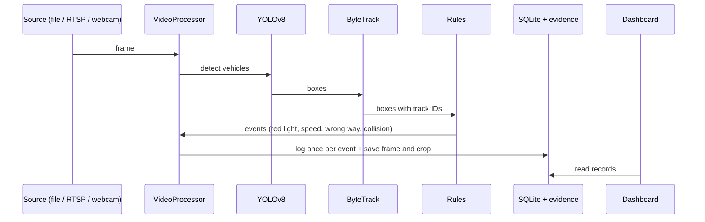

# Architecture

How Traffic Agent is put together, how data flows through it, and why.

## Components

| Layer | Location | Responsibility |
|---|---|---|
| Detection | `app/detection/detector.py` | YOLOv8 finds cars, motorcycles, buses and trucks in each frame. |
| Emergency detection | `app/detection/emergency_detector.py` | Optional second model (`models/emergency_vehicle.pt`) for ambulance, fire truck and police car. |
| Tracking | `app/tracking/tracker.py` | ByteTrack (Supervision) gives each vehicle a stable ID across frames. |
| Violation rules | `app/violation/` | Red light, speed, wrong way, collision and fine logic. Pure Python, no models, easy to test. |
| Signal priority | `app/emergency/signal_priority.py` | Simulated green override when an emergency vehicle is seen. |
| Pipeline | `app/video_processor.py` | Runs detect, track, check, draw, record for every frame. Used by the dashboard and the CLIs. |
| Storage | `app/violation/violation_logger.py`, `app/database/` | SQLite tables and evidence images. |
| Alerts | `app/alerts/twilio_alert.py` | Opt-in SMS or voice call on a possible collision. |
| Dashboard | `app/main.py`, `app/ui/` | Streamlit pages, sign-in, roles, theme. |
| Operations | `app/ui/auth.py`, `app/users.py`, `app/audit.py`, `app/housekeeping.py`, `app/health.py`, `app/ratelimit.py` | Users and roles, audit log, retention, health check, rate limits. |

## Data flow

Each event has a key (`kind:source:track:frame`) with a `UNIQUE` constraint, so
re-processing never writes the same event twice.

## Data model

Created automatically by `app/violation/violation_logger.py`:

| Table | Holds |
|---|---|
| `violation_records` | One row per violation: type, track ID, speed and limit, signal state, fine, timestamp, evidence and crop paths, source, camera, plate text and confidence. |
| `collision_events` | Pair of track IDs, evidence, alert status and alert latency. |
| `priority_events` | Emergency vehicle class, confidence, whether the signal override was applied. |
| `traffic_density` | Vehicle count per video second. |
| `audit_log` | Who did what and when (sign-ins, admin actions). Created by `app/audit.py`. |

Older databases are upgraded in place: missing columns are added on start.

## Design decisions

* **Rules are separate from models.** Violation logic takes boxes and IDs, so
  it is unit tested without YOLO. CI also runs a real YOLO + ByteTrack smoke test.
* **Signal is simulated.** The camera cannot read a real signal; the app uses a
  fixed or cycling state (`app/violation/signal.py`) and says so on screen.
* **Evidence is drawn after checks and saved from a clean copy for crops**, so
  crops are not covered by boxes.
* **Emergency model is optional.** Without the weights the app runs normally.
* **Supervision is pinned** (`>=0.20,<0.31`) because ByteTrack's API changed.
* **Roles are enforced in the UI layer** (`viewer`, `operator`, `admin`); see
  [CONFIGURATION.md](CONFIGURATION.md) for sign-in modes.
* **State lives in one data folder** (`TRAFFIC_AGENT_DATA_DIR`), which makes
  Docker volumes and backups simple.

## Testing strategy

`tests/` uses small test doubles for Streamlit (`tests/fake_streamlit.py`) and
a temporary database helper (`tests/db_helpers.py`). Scripts under
`scripts/manual_checks/` are for hand testing with real models and are not run by pytest.
